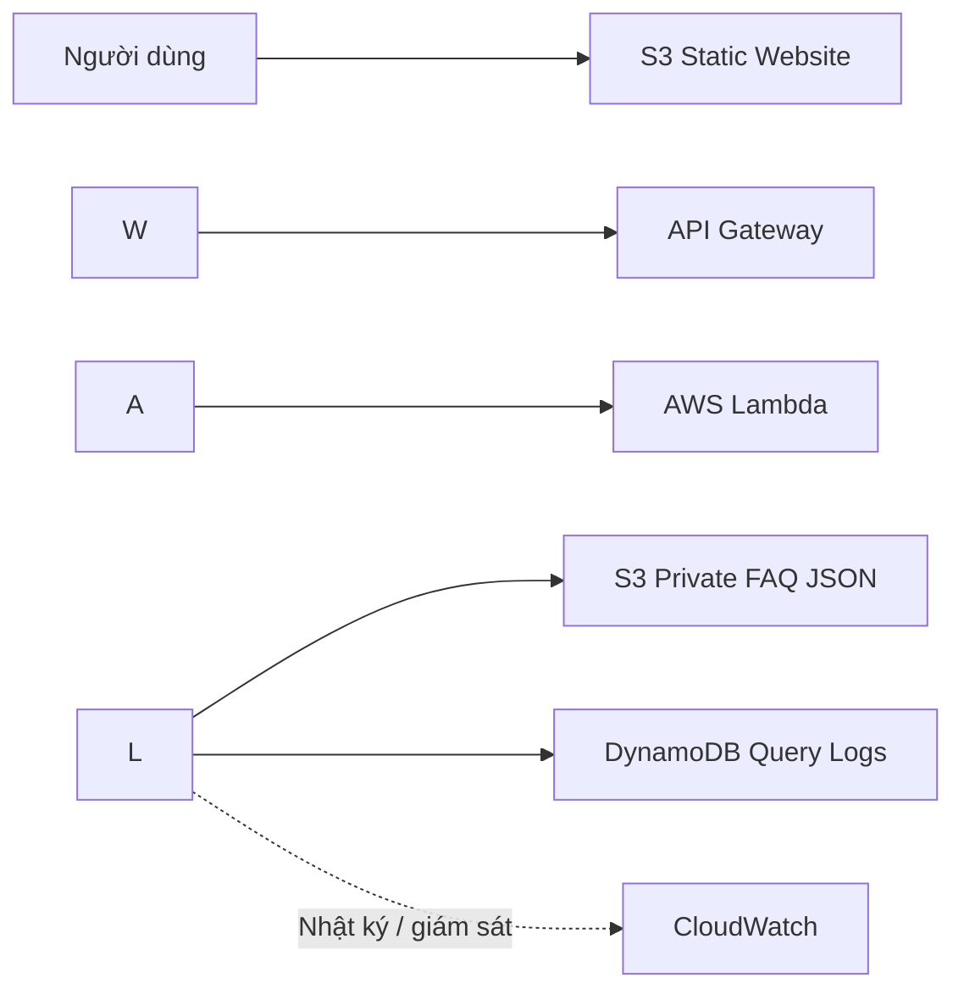

# BÁO CÁO TIẾN ĐỘ THỰC HIỆN ĐỒ ÁN

## CHATBOT HỎI ĐÁP TÀI LIỆU MÔN HỌC DÙNG LAMBDA VÀ CƠ SỞ TRI THỨC TRÊN S3

**Học phần:** Cloud - Đợt 1 - Năm học 2026–2027  
**Tên đề tài chính thức:** Chatbot hỏi đáp tài liệu môn học dùng Lambda và cơ sở tri thức trên S3  
**Nhóm:** Serverless  
**Giảng viên hướng dẫn:** Huỳnh Xuân Phụng  
**Sinh viên thực hiện:** Ngô Anh Bằng — MSSV **24110166**; Đặng Nguyễn Minh Khoa — MSSV **24110253**  
**Thời gian thực hiện:** 4 tuần; tối thiểu 8 giờ/sinh viên/tuần  
**Trạng thái đề tài:** Đang thực hiện  
**Phạm vi báo cáo:** Kết quả thực hiện tuần 1 và kế hoạch triển khai tuần 2.

## 1\. Mục tiêu và yêu cầu đề tài

Xây dựng ứng dụng hỏi đáp FAQ cho môn học theo kiến trúc serverless sử dụng **AWS Lambda, Amazon API Gateway, Amazon S3, Amazon DynamoDB**. Hệ thống **không gọi API LLM bên ngoài**; nhóm tự lập trình thuật toán tìm kiếm/so khớp câu hỏi (dự kiến TF-IDF và cosine similarity). Chạy và kiểm thử thực tế trong **AWS Learner Lab**.

Các ràng buộc bắt buộc: chỉ sử dụng Region `us-east-1` hoặc `us-west-2`; dùng `LabRole`/`LabInstanceProfile` sẵn có, không tạo IAM user/role; gắn tag `Project` và `Owner`; dừng hoặc xóa tài nguyên sau buổi làm việc khi phù hợp; ghi chi phí cuối kỳ. Nếu dùng EC2 thì chỉ loại nano–large, tối đa 9 instance và 32 vCPU chạy đồng thời mỗi Region; tổng EBS không quá 100 GB, loại gp2/gp3. Đề tài hiện không yêu cầu EC2 hoặc EBS.

## 2\. Kiến trúc hệ thống

**Hiện trạng:** `GET /health` đã có mã Lambda và ảnh minh chứng API; luồng hỏi đáp `POST /ask`, tìm kiếm FAQ và ghi DynamoDB mới là **thiết kế dự kiến**, chưa có trong mã nguồn tuần 1.

## 3\. Công việc đã hoàn thành — Tuần 1

| Hạng mục           | Kết quả đã có / minh chứng                                                                                  | Trạng thái                                   |
| ------------------ | ----------------------------------------------------------------------------------------------------------- | -------------------------------------------- |
| Khảo sát, thiết kế | `docs/architecture.md`, `README.md` mô tả kiến trúc và các bước triển khai                                  | Có tài liệu                                  |
| S3 lưu website     | `frontend/index.html`, `style.css`, `app.js`; ảnh cấu hình hosting, bucket policy, upload và website public | Có mã và ảnh minh chứng                      |
| S3 lưu dữ liệu     | `data/faq.json` có 12 FAQ minh họa; ảnh tạo bucket và upload                                                | Có dữ liệu và ảnh minh chứng                 |
| Lambda             | `lambda/lambda\_function.py` trả HTTP 200, `status: ok`, `phase: week-1`; ảnh tạo hàm và chỉnh mã           | Có mã và ảnh minh chứng                      |
| API Gateway        | Route `GET /health`; ảnh cấu hình route/stage và gọi API thành công                                         | Có ảnh minh chứng                            |
| DynamoDB           | Bảng dự kiến `CourseFAQQueryLogs`, khóa `requestId` kiểu String; ảnh tạo bảng                               | Có ảnh minh chứng; chưa có mã ghi dữ liệu    |
| Kiểm thử           | `tests/test\_lambda.py` kiểm tra HTTP 200 và `status=ok`                                                    | Có bài test; chưa xác minh lệnh test đã chạy |
| Nhật ký công việc  | `docs/worklog-week1.md` là mẫu phân công, chưa điền giờ thực tế                                             | **Chưa hoàn tất**                            |
| Tag / IAM / Region | README hướng dẫn `LabRole`, `us-east-1`, tag `Project`/`Owner`                                              | **Cần kiểm tra bằng ảnh console**            |

**Giới hạn tuần 1:** Giao diện mới là bản mẫu, `app.js` chưa gọi API; Lambda mới xử lý health check; chưa có thuật toán tìm kiếm, endpoint `POST /ask`, ghi nhật ký DynamoDB, CloudWatch monitoring hoàn chỉnh hoặc số liệu chi phí. Không ghi những hạng mục này là đã hoàn thành.

## 4\. Kế hoạch triển khai tuần 2

**Mục tiêu:** Hoàn thiện chức năng hỏi đáp tài liệu môn học trên AWS Lambda, kết nối API Gateway với dữ liệu FAQ lưu tại Amazon S3 và lưu nhật ký truy vấn vào Amazon DynamoDB. Thuật toán tìm kiếm do nhóm tự xây dựng, không gọi API LLM bên ngoài.

| Sinh viên                            | Nội dung công việc dự kiến                                                                                                                                                 | Thời lượng dự kiến | Kết quả cần đạt                                                                                                  |
| ------------------------------------ | -------------------------------------------------------------------------------------------------------------------------------------------------------------------------- | -----------------: | ---------------------------------------------------------------------------------------------------------------- |
| **Ngô Anh Bằng (24110166)**          | Xây dựng thuật toán chuẩn hóa câu hỏi, biểu diễn TF-IDF và tính cosine similarity; lập trình xử lý `POST /ask` trên Lambda; kiểm thử kết quả tìm kiếm và ngưỡng phù hợp    |          **8 giờ** | Lambda nhận câu hỏi và trả về câu trả lời phù hợp hoặc thông báo không tìm thấy; có mã nguồn và kết quả kiểm thử |
| **Đặng Nguyễn Minh Khoa (24110253)** | Rà soát và bổ sung dữ liệu FAQ JSON trên S3; lập trình Lambda đọc cơ sở tri thức từ S3; tích hợp ghi lịch sử truy vấn vào DynamoDB; kiểm thử quyền truy cập và lưu dữ liệu |          **8 giờ** | Lambda đọc được FAQ từ S3, ghi được nhật ký truy vấn vào DynamoDB; có ảnh AWS và kết quả kiểm thử                |

### 4.1. Các bước triển khai

1. Chuẩn hóa dữ liệu FAQ trên S3, xác định cấu trúc câu hỏi, câu trả lời và từ khóa.
2. Tự cài đặt thuật toán tìm kiếm TF-IDF và cosine similarity bằng Python, không sử dụng dịch vụ LLM/API AI bên ngoài.
3. Nâng cấp Lambda để xử lý yêu cầu hỏi đáp, đọc FAQ từ S3 và trả kết quả dưới dạng JSON.
4. Cấu hình API Gateway cho endpoint `POST /ask`, kiểm tra request/response và các trường hợp lỗi.
5. Ghi thông tin truy vấn vào bảng DynamoDB; kiểm thử việc ghi và truy xuất dữ liệu.
6. Kiểm thử độc lập từng thành phần và lưu ảnh minh chứng trên AWS Learner Lab.

### 4.2. Tiêu chí hoàn thành tuần 2

- Endpoint `POST /ask` hoạt động qua API Gateway và AWS Lambda.
- Dữ liệu trả lời được tìm kiếm từ tệp FAQ trên S3 bằng thuật toán do nhóm tự cài đặt.
- Lịch sử truy vấn được ghi vào DynamoDB.
- Có kiểm thử cho câu hỏi khớp, không khớp, dữ liệu đầu vào rỗng và lỗi truy cập dịch vụ.
- Hai sinh viên cập nhật worklog tuần 2 với tối thiểu 8 giờ thực tế/người, kèm mã nguồn, ảnh console/CLI và kết quả kiểm thử.
- Tài nguyên triển khai tuân thủ quy định Region, LabRole và gắn tag `Project`/`Owner`.

Link github: https://github.com/bawgitne/CloudComputing.git
