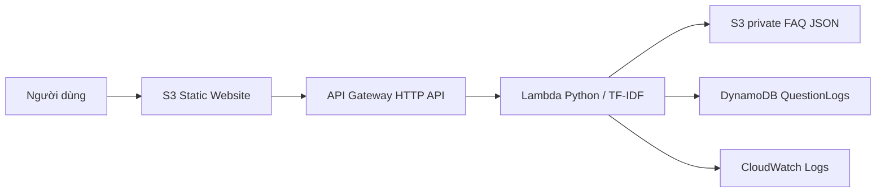

# Kiến trúc dự kiến

**Tuần 1:** S3 web skeleton, S3 private FAQ, Lambda healthcheck, DynamoDB table, API /health.
**Tuần 2:** triển khai thuật toán TF-IDF, POST /ask và DynamoDB logging.
**Tuần 3:** frontend kết nối /ask, CORS, giám sát và bảo mật.

> Lambda không cần đặt trong VPC cho kiến trúc này. Nếu phải chứng minh tạo VPC, tạo VPC riêng không nối Lambda, rồi xoá sau buổi học.
